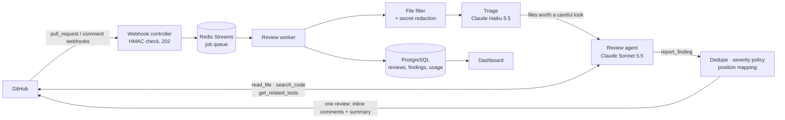

# AI Code Review Bot

A GitHub App that reviews pull requests with Claude. On every push it reads the changed code, decides which files deserve a careful look, lets an agent investigate them with tools, and posts **one review** with line-by-line comments on bugs, security issues and missing tests, one-click suggested fixes, and a summary.

> 🔴 **Critical** · Security
>
> **Query built from request parameter allows SQL injection**
>
> `name` is concatenated into the SQL string, so `x' OR '1'='1` returns every user. Bind it as a parameter instead.
>
> ```suggestion
> String sql = "SELECT id, name, email FROM users WHERE name LIKE ? ORDER BY name";
> ```
>
> <sub>#1 · Reply with `@reviewbot explain` or `@reviewbot fix`</sub>

## Features

| Feature | What the user sees |
|---|---|
| **Automatic review** | Comments on the exact changed lines, usually within a minute of a push |
| **Severity labels** | 🔴 Critical · 🟠 Major · 🟡 Minor · 💡 Suggestion |
| **Suggested fixes** | GitHub `suggestion` blocks the author applies with one click |
| **PR summary** | "Reviewed 7 files · 🔴 1 critical · 🟠 2 major · 🟡 3 minor", with a table linking every finding |
| **Chat commands** | Reply `@reviewbot explain` or `@reviewbot fix` to a finding, or `@reviewbot explain 3` on the conversation tab |
| **Per-repo config** | `.reviewbot.yml`: ignored paths, minimum severity, focus areas, language rules, comment cap |
| **Incremental reviews** | A new push re-reviews only files changed since the last reviewed commit, and never repeats a finding |
| **Dashboard** | Installations, repositories, PRs reviewed, findings by severity, accepted suggestions, spend, latency, cache hit rate |
| **MCP server** | The same GitHub tools exposed over MCP for Claude Code and Claude Desktop |

## How it works



1. **Webhook.** `X-Hub-Signature-256` is verified against the raw body in constant time. The endpoint answers `202` immediately and queues a job, because GitHub expects a fast response.
2. **Authenticate as the App.** A short-lived RS256 JWT, signed with the App's private key, is exchanged for an installation token scoped to that installation's repositories. Tokens are cached until shortly before they expire.
3. **Fetch and filter.** The changed files and their patches are loaded, `.reviewbot.yml` is read from the **base** commit (so a pull request cannot switch off its own review), and lockfiles, binaries, generated or vendored code, huge diffs and ignored paths are skipped with a stated reason.
4. **Redact.** Anything that looks like a key, token or password is replaced with `[REDACTED:kind]` before code reaches the model, keeping line numbers intact. High-confidence secrets on added lines are reported directly as critical findings.
5. **Triage, then deep review.** Claude Haiku 5.5 decides per file (structured output, batched) whether a careful review is worth it; trivial changes stop here. For the rest, a Claude Sonnet 5.5 agent runs a tool loop per file: it reads files, searches for callers, checks for tests, and reports each problem through the `report_finding` tool, which validates the line against the diff so the model can correct itself. Files run in parallel on virtual threads.
6. **Post-process.** Duplicate findings are merged, `min_severity` and `focus` are applied, findings already posted on an earlier commit are dropped (by a fingerprint of file, category and line content), and line numbers are mapped onto positions GitHub accepts. Off-by-one lines snap to the nearest diff line; anything outside the diff goes to the summary.
7. **Post.** One review with all inline comments and a summary. If GitHub rejects a comment position, the review is re-posted as a summary so nothing is lost. Findings, token usage, cost and latency are stored for the dashboard.
8. **Follow-ups.** `@reviewbot explain` / `fix` triggers one short Claude call with the finding and the code around it; the answer goes back into the same thread (a `fix` in a thread is a one-click suggestion).

### Claude API usage

- **Model routing:** `claude-haiku-5-5` (low effort) for triage, `claude-sonnet-5-5` (medium effort) for the review agent and chat commands, all configurable.
- **Prompt caching:** the tools and the system prompt (including the repository's rules) carry an explicit cache breakpoint and are byte-identical for every file of a pull request; automatic caching covers each agent's growing conversation. The first agent of a review goes ahead alone so the others read its cache entry instead of each paying for a write.
- **Structured data, not prose:** findings only arrive through a `strict` tool schema; triage and fixes use structured outputs.
- **Refusals:** responses are read by stop reason before content. Review and chat calls opt into server-side refusal fallback (`fallbacks: "default"`); a file the model still declines is noted in the summary instead of failing the review.
- **Manual agent loop:** the loop (not the SDK's tool runner) is written out because the tools need per-review state (diff, repository access, search allowance) and a token budget shared by parallel agents.

## Tech stack

Java 21 · Spring Boot 3.5 (Web MVC, Data JPA, Data Redis, Security, Actuator, Thymeleaf) · Anthropic Java SDK · PostgreSQL 17 + Flyway · Redis 7 Streams · Spring AI MCP server · JUnit 5, Mockito, WireMock, Testcontainers · Docker · GitHub Actions · Azure Container Apps

## Project layout

```
ai-code-review-bot/
├── reviewer-app/          Spring Boot service: webhook, queue, review pipeline, dashboard
│   └── src/main/java/com/example/reviewbot/
│       ├── webhook/       controller, HMAC verification, event payloads
│       ├── github/        App auth (JWT → installation token), REST client, diff parser, position mapper
│       ├── queue/         Redis Streams job queue and workers (retries, dead letters, crash recovery)
│       ├── review/        orchestrator, pipeline, file filter, chunker, dedupe, severity policy, redaction
│       ├── ai/            Claude client, model routing, pricing, triage, agent and its tools
│       ├── command/       @reviewbot explain / fix
│       ├── dashboard/     stats page
│       └── model/ repository/ installation/ config/
├── mcp-server/            the GitHub tools over MCP (stdio)
├── eval/                  seeded-bug dataset and the evaluation runner
├── docs/install-guide.md  GitHub App setup, local run, deployment, MCP setup
├── docker-compose.yml     app + PostgreSQL + Redis
├── .reviewbot.example.yml
└── .env.example
```

## Getting started

You need JDK 21, Docker, a GitHub account and an [Anthropic API key](https://console.anthropic.com).

1. **Create the GitHub App** with the permissions and events in [docs/install-guide.md](docs/install-guide.md), generate a private key, and install the App on a test repository.
2. **Configure:** copy `.env.example` to `.env` and fill in the App ID, slug, private key, webhook secret and API key.
3. **Run:**
   ```bash
   docker compose up --build
   ```
4. **Expose the webhook** while developing, e.g. with [smee.io](https://smee.io) or `ngrok http 8080`, and set the App's webhook URL to `https://<your-host>/api/github/webhook`.
5. **Open a pull request** in the test repository. The review appears within a minute; the dashboard is at `http://localhost:8080/dashboard`.

Health and readiness: `GET /actuator/health`, `/actuator/health/liveness`, `/actuator/health/readiness`.

## Configuration

Each repository can add a `.reviewbot.yml` (see [`.reviewbot.example.yml`](.reviewbot.example.yml)):

```yaml
min_severity: minor          # critical | major | minor | suggestion
ignore:
  - "**/generated/**"
  - "**/*.lock"
focus:
  - security
  - null-safety
  - tests
language_rules:
  java:
    - "Prefer Optional over returning null"
    - "Close resources with try-with-resources"
max_comments: 15
```

Invalid settings never fail a review: they fall back to defaults and show up as notes in the summary. Service-wide settings (models, effort, budgets, limits, queue) live in [`application.yml`](reviewer-app/src/main/resources/application.yml) and can be overridden with environment variables, e.g. `REVIEWBOT_AI_MODELS_REVIEW`.

## Security and reliability

- **Webhook signatures** are verified on every request; unsigned or tampered deliveries get `401`.
- **Least-privilege App permissions:** Pull requests read & write, Contents read-only, Metadata read-only, Issues read-only (only to receive conversation-tab commands).
- **Secrets** come from the environment or a secret store, never the repository. The dashboard sits behind HTTP Basic auth.
- **Secret redaction** before anything is sent to the model, with direct findings for committed credentials.
- **Prompt-injection defence:** repository content is wrapped in tags and treated as data; closing tags inside code are neutralised so a crafted comment cannot break out of its block.
- **Idempotency:** `(repo, pr_number, commit_sha)` is unique, so a commit is never reviewed twice; retried posts look for the review's hidden marker before posting again; chat commands are answered once per comment.
- **Durable queue:** jobs survive restarts, retry with exponential backoff on transient errors, are reclaimed from crashed workers after a visibility timeout, and end in a dead-letter stream with the error.
- **Budget guard:** token and dollar limits per pull request, per chat command and per installation per day.

## Evaluation

[`eval/`](eval) holds 30 cases: 25 diffs with seeded bugs (SQL and command injection, path traversal, SSRF, XSS, missing authorization, weak hashing, predictable tokens, hardcoded credentials, null dereferences, off-by-one, integer division, string identity, races, deadlock, unsafe shared formatters, concurrent map writes, resource leaks, swallowed exceptions, missing awaits and timeouts, ignored errors, N+1 queries, unbounded caches, untested logic) in Java, Python, TypeScript, JavaScript and Go, plus 5 clean diffs that should get no comments. Each case has a `diff.patch`, the files after the change (`repo/`) and `expected.json`.

The runner sends every case through the production pipeline (same prompts, models, limits, triage, dedupe and policy) and reports:

| Metric | How it is measured |
|---|---|
| **Recall** | Share of seeded bugs with a finding on the same file within a few lines |
| **Precision** | Share of findings (minor and above) that match a seeded bug; clean diffs should get none |
| **Cost / PR** | Sum of the token usage of all calls, priced from `application.yml` |
| **Latency / PR** | Wall-clock time of the pipeline per case |

```bash
./mvnw -pl eval -am package -DskipTests
ANTHROPIC_API_KEY=... java -jar eval/target/eval-1.0.0.jar --dataset eval/dataset --out eval/results
```

It prints a one-line headline (`Catches X/26 seeded bugs (…% recall), …% precision, avg $… and …s per PR.`) and writes `eval/results/report.md` and `results.json`. The **Eval** workflow runs it nightly and on demand when the `ANTHROPIC_API_KEY` secret is set, and posts the report to the run summary.

## MCP server

`mcp-server` exposes `read_file`, `search_code` and `list_prs` over the Model Context Protocol (stdio), so Claude Code or Claude Desktop can explore a repository the same way the review agent does. Setup is in the [install guide](docs/install-guide.md#mcp-server).

## Development

```bash
./mvnw verify
```

runs the unit tests and the integration tests. `WebhookFlowIT` drives the whole flow (signed webhook → queue → worker → triage → agent tool loop → review on GitHub, plus idempotency, signature rejection and a chat command) against real PostgreSQL and Redis from Testcontainers, with GitHub and the Claude API stubbed by WireMock. Without Docker it falls back to an embedded PostgreSQL and a bundled Redis binary (or, where native binaries are blocked, an in-memory queue).

## Design notes

- **Comments are anchored with `line`/`side`** (and `start_line` for ranges) rather than the legacy diff `position`, which also allows multi-line suggestions. A suggestion is only offered when its anchor is exact, because it replaces exactly the anchored lines.
- **Triage fails open:** if the triage call fails, every file gets a deep review; cost goes up, coverage does not go down.
- **The review never blocks merges:** it is posted as `COMMENT`, never `REQUEST_CHANGES` or `APPROVE`.
- **Suggestion acceptance** (`finding.accepted`) is detected when a later commit contains the suggested code, which makes it a real-world quality signal on the dashboard.
